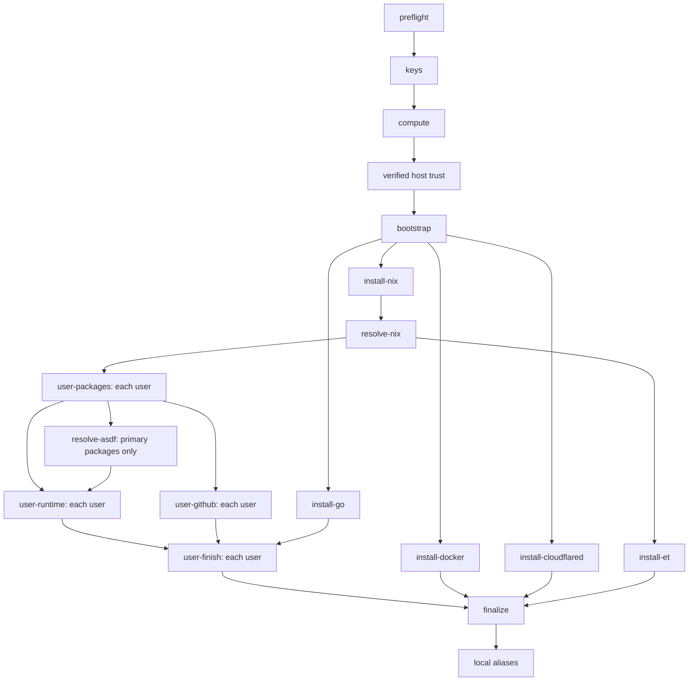

# Walter

Walter provisions one Google Cloud development machine and its user environments
using Python and [PocketDeploy](https://github.com/pocketcontext/pocketdeploy).
There is no Terraform/OpenTofu, Ansible or Clojure orchestration. Nix, asdf, Git,
OpenSSH, Google Cloud CLI and downloaded tool installers remain external tools.

This repository owns the reusable package, canonical skill, tests and generic
configuration. The active deployment lives in
[getcolors/walter-gcp](https://github.com/getcolors/walter-gcp), with its own
configuration, pinned launcher and private controller state. Historical Walter
deployments retain their independent pins and state.

## Setup

Install uv, OpenSSH, gcloud and GitHub CLI. Authenticate Google Application Default
Credentials for the configured project and authenticate `gh` as `github-account`.
From a deployment checkout, use its copied, immutable `walter` launcher:

```sh
./walter --help
./walter plan
./walter status
./walter ssh
```

For a new deployment, start with [examples/colors.yml](examples/colors.yml), select
its own profile and provider scope, and copy the pinned launcher from
`skills/walter/walter`. Initialize only a new deployment with `./walter init`.
After reviewing the plan and obtaining authorization for provisioning:

```sh
./walter vault-save
./walter converge --verbose
./walter vault-save
```

Source development uses `uv sync --locked --extra test` and `uv run walter`.
Running source commands does not update a deployment's immutable launcher pin.

Run without arguments for help. Configuration defaults to `colors.yml` in the
current directory; use `-f /absolute/path/colors.yml` to select another deployment.
`plan` and `converge --dry-run` read cloud resources without creating authority.
The plan describes infrastructure changes and intended user reconciliation;
it does not predict every package-manager change.

## Configuration

The existing `google-*` and tooling keys remain the desired-state vocabulary.
They normalize into PocketDeploy's `gcp-*` settings internally. `provider-compute`
is `google`; only Google Cloud is supported. The durable `profile` supplies the
resource-name prefix. New names use `<profile>-<component>-<purpose>`, omitting
redundant components, with immutable provider IDs and ownership labels recorded
separately. Environment overrides follow PocketDeploy; recorded state identity
must still match the resulting profile and provider scope.

Existing `google-network` and `google-subnet` are required infrastructure
references (both default to `default`). Region/zone must agree. Walter owns only
its VM, boot disk and firewall rules; it does not own the network or subnet.
SSH sources default to all IPv4 addresses; set `walter-ssh-sources` to narrower
CIDRs when appropriate. The shared HTTP/HTTPS firewall rule is disabled.
Inherited network firewall rules can grant broader access.

N4A uses ARM64 Ubuntu, `hyperdisk-balanced` and `GVNIC`. C4A `-lssd` shapes require
their fixed `google-local-ssd-count`; `local-ssd-scratch: true` mounts one disposable filesystem at `/scratch` and
bind-mounts `/home`, `/nix`, `/tmp`, `/var/tmp`, `/var/lib/docker` and
`/var/lib/containerd` onto it. This layout requires a fresh machine. The boot disk
retains the OS, configuration, logs and Walter metadata. Mounts precede user setup,
temporary-file initialization and dependent services. The helper refuses foreign
filesystems and unsafe ownership. Local SSD data is disposable.

Walter uses PocketDeploy's configuration normalization, deployment sessions,
operation journal, compute deletion, `.colors.sqlite`, `.ssh/` authority and local lock.
Pinned SSH transport is prepared before parallel user work; shared alias updates
preserve Walter's existing ownership markers and use PocketDeploy's common lock.
One controller at a time is supported. There is no backend bucket. Missing state
or authority requires recovery, not adoption by name. Host bootstrap keys rotate
before application credentials are transmitted. `ssh-install` refreshes owned
primary/seat aliases; `ssh-uninstall` removes only aliases. `ssh` resolves the live
owned address and supports `--ssh-command` for explicit commands.

`clone-orgs` discovers non-archived, non-fork repositories. `clone-repos` names
explicit repositories, including archived repositories or forks when requested:

```yaml
clone-repos:
  - basecamp/once
  - pocketbase/pocketbase
  - benbjohnson/litestream
```

The combined list is deduplicated and cloned with two workers per user into
`~/code/<owner>/<repo>`. Existing checkouts are preserved without automatic pulls.

Include `eternal-terminal` in `nix-packages` to install the client for each user
and configure the root-owned Nix server profile and `et.service`. TCP 2022 uses
the same source CIDRs as SSH. With ET installed on your client, connect through
Walter's SSH aliases using `et walter-gcp`, `et walter-gcp-jack` or
`et walter-gcp-rose`.

## Google Workspace CLI

Set `gws: true` with a configured `nodejs` entry in `asdf-tools` to install
`@googleworkspace/cli@0.22.5` globally through each user's asdf npm runtime.
Walter refreshes the Node.js shims and verifies `gws --version`. Matching package
versions are retained on repeat convergence; a different version is replaced by
the pinned version. The option defaults to false.

```yaml
gws: true
asdf-tools:
  - name: nodejs
    version: latest
    plugin: https://github.com/asdf-vm/asdf-nodejs.git
```

Authenticate separately as the intended user with `gws auth login --services drive`.
Walter does not seed Google Workspace credentials or run OAuth login.

## Shared Go

`go-version: 1.27.2` installs the official checksum-pinned Go distribution once
at `/usr/local/go`. The remote architecture selects Linux ARM64 or AMD64;
unsupported architectures fail before replacing the existing installation.
Downloads are verified and extracted into a fresh staging tree before replacement.
The compiler is root-owned and readable/executable by all users. Bash and Fish
receive Go paths, with `go` and `gofmt` also linked into `/usr/local/bin`.
Each user retains their own `~/go/bin`, module cache and build cache.
Only releases with checksums pinned in Walter are accepted.

## Private settings

Every variable assigned in `.envrc.private` must start with **`COLORS_PAR_`**.
Keep the file private and ignored. Values never belong in `colors.yml`, command
arguments, logs or Git. Load private settings in your trusted shell; the CLI does
not source shell files. Atuin requires:

```sh
export COLORS_PAR_ATUIN_PASSWORD=""
export COLORS_PAR_ATUIN_KEY=""
```

Fill the values privately. `COLORS_PAR_*` overrides for supported configuration
fields follow the shared Colors convention. Unrelated environment variables are
not copied into desired state. Google and GitHub authenticate through their CLI
credential stores; VaultContext uses its already configured client session.

Convergence verifies the current `gh` account and transfers its token only when a
configured remote login lacks the expected GitHub identity. It does not create a
new GitHub OAuth grant. Tokens travel through SSH stdin, never argv or SQLite.
Deleting a VM does not revoke the underlying GitHub credential.

Optional agent seeding reads only the named credential files for Claude, Codex and
Pi, never transcript directories. Existing remote credential files are preserved.
Seat users have private homes and no sudo or Docker-group access. They share the
configured GitHub/agent identities and host networking; seats are not separate
cloud or service accounts. The primary user remains privileged.

## Convergence and recovery

The workflow is preflight → local keys → compute → verified host trust →
bootstrap → dependency-driven software provisioning → finalization → local aliases.
Bootstrap prepares prerequisites, scratch storage and private accounts. Go, Docker,
cloudflared and Nix then install concurrently. Nix consumers start as soon as Nix and its
pinned revision are ready; Docker and Eternal Terminal do not block user setup.
Each user's package transaction precedes independent Git and runtime branches.
The primary user's asdf installation resolves `latest` versions once for all users.
Shell configuration, agent installers, credentials, dotfiles, Emacs launching and
Atuin follow the user's Git/runtime branches and shared Go verification.

Cloudflared 2026.10.0 installs system-wide at `/usr/local/bin/cloudflared` from
an official Linux ARM64 or AMD64 binary with a pinned SHA-256 checksum. The
installer verifies the staged binary before atomic replacement and retains an
existing verified matching installation. It does not use APT/dpkg, so it can run
alongside Docker installation. No tunnel or service is configured. Finalization
waits for cloudflared and all other provisioning tasks to succeed.



Each user's runtime waits for their own packages and the shared asdf resolution.
`user-finish` includes shell paths, configured agent CLI installers (including
Codex and Claude Code), credential seeding, dotfiles, Emacs and Atuin. Agent CLI
installers run sequentially within a user task; different users run concurrently.

At most six remote tasks run at once, with two clone workers per active Git task.
Compilation remains limited to one job per user. User tasks run in separate
processes with permanently dropped privileges. Machine/resource locks and a
convergence token reject conflicting or delayed tasks; focused convergence commands
retain exclusive machine access. Failure stops new tasks and drains running work
before returning. Progress is recorded per task; successful convergence includes
relative start/finish timings under `provisioning.task_timings`.

Nix uses one resolved nixpkgs `nixos-26.05` revision. Atuin uses its official release binary installer,
`https://github.com/atuinsh/atuin/releases/latest/download/atuin-installer.sh`,
run as each user without the setup wrapper that registers coding-agent hooks.
It installs the current upstream release in `~/.atuin/bin` when absent. Walter
verifies it before removing any previous Nix Atuin entry and includes its directory
in Bash, Fish and provisioning PATHs. Existing installations are retained on
repeat convergence; history and credentials are preserved. Nix/asdf and standalone agent installers
configure each home. Focused commands operate on the recorded
owned machine. Dotfiles use a small Python renderer for the checkout's Ubuntu
profile, preserving existing user files; the checkout's old launcher is never
executed. Emacs package warming runs asynchronously alongside Atuin synchronization; inspect
`~/.local/state/walter/emacs-packages.log` for completion.

Walter does not install or remove coding-agent hooks. Existing agent configuration
is preserved. Shell history initialization is managed by dotfiles or user
configuration; the configured Fish dotfiles already run `atuin init fish`.

`vault-id` selects a dedicated vault; `vault-command` selects its installed CLI.
The user must authenticate and unlock it. `vault-save` is an explicit checkpoint
of private bindings, operator/bootstrap keys, known hosts and SQLite. It does not
back up the remote home directories or boot volume. Preserve remote work separately.
Save after successful mutations and after failures that changed resource state.

```sh
./walter vault-restore --document DOCUMENT --version VERSION \
  --destination /absolute/recovery/directory
```

Place matching Git configuration in the destination first. Restore never runs a
deployment or sources private bindings. Review `plan` before takeover. Old recovery
checkpoints may require reconciliation against live resources.

Deletion requires `compute-prevent-destroy: false`. Review `delete --dry-run`,
then `delete` removes owned compute, boot storage, firewall rules and local SSH
keys/aliases. It retains the SQLite receipt, configuration and Vault history.
Deletion destroys remote work; recovery checkpoints do not contain that work.

## Failure diagnostics

Failures report validated operation names, categories, exit codes or signals,
elapsed time and recognized HTTP status codes. Walter attaches task and user
context from the controller. Atuin failures recognize a small set of HTTP and
transport signatures; unrecognized errors retain their exit status without a
speculative cause. Failed-operation evidence remains in controller history after
successful retries.

Command arguments, stdout/stderr, provider bodies, URLs, credential paths and
exception text remain private. Remote diagnostics are allowlisted before they
cross the controller boundary. There is no output masking or excerpt mode.
PocketDeploy owns the shared schema, transport and history support; Alice uses
the same schema for provisioning, Transmission RPC and file-copy failures.

For an explicitly authorized Atuin investigation, set
`COLORS_PAR_ATUIN_SYNC_CAPTURE=true` for convergence. This captures only
`atuin sync`, never interactive login or credential inputs. Each user’s latest
attempt is written to `~/.local/state/walter/atuin-sync.json`; each output stream
retains a bounded tail and records whether it was truncated. The file contains
unmasked output and is readable only by its owner and root. Normal CLI results
and controller history continue to contain structured diagnostics only.
Read the capture through authorized SSH access before retrying, since the next
captured attempt replaces it. Remove it after the investigation. The option is
off by default and can also be set with `atuin-sync-capture: true` in configuration.

Walter requires Atuin 18.18.0 or newer on the effective user PATH. After the first
successful compatible sync, it runs `atuin store rebuild history` once and writes
a completion marker. This repairs history records downloaded by an older client
before that client rejected the v2 format. A failed sync or rebuild never writes
the marker; ordinary retries remain explicit.

## Development

```sh
uv sync --locked --extra test
uv run pytest -q
uv build
uv run python scripts/test-launcher.py
```

Synthetic tests cover configuration, controller behavior, secrets, privilege
boundaries, local aliases and scratch recovery. Shared cloud/SSH tests live in
PocketDeploy. Historical package verification is recorded in
[docs/verification.md](docs/verification.md). Current deployment records live in
[walter-gcp](https://github.com/getcolors/walter-gcp/blob/main/docs/verification.md).

For an authorized deployed-machine check, run `uv run python scripts/verify-live.py
-f /absolute/path/to/deployment/colors.yml`.
After fresh provisioning, run `uv run python scripts/verify-atuin-hooks.py
-f /absolute/path/to/deployment/colors.yml` to check
agent-hook absence and interactive Fish integration for every configured user.
Both commands report allowlisted verification results without configuration contents.
